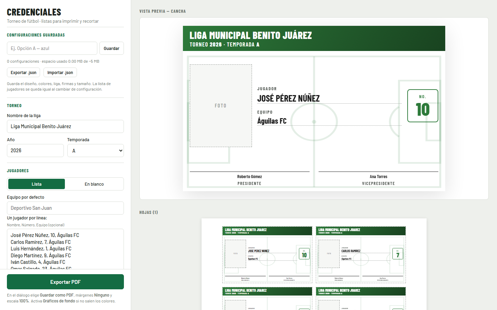
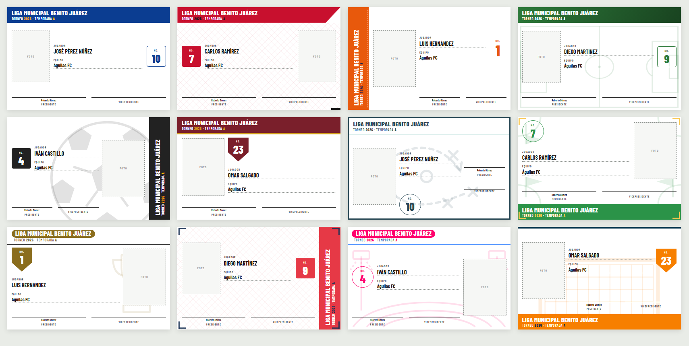
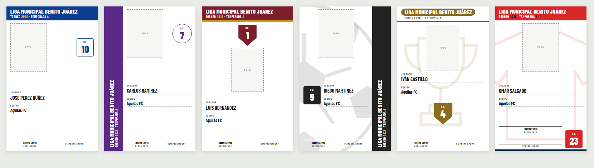

# ⚽ Fichaje — Credenciales para torneos de fútbol

[](LICENSE)


Genera credenciales de jugador para ligas y torneos de fútbol, listas para **imprimir en PDF, recortar y entregar**. Pega tu lista de jugadores (o sube un CSV de Excel), elige uno de los **50 diseños** y exporta. Sin instalar nada, sin cuentas y sin subir datos a ningún servidor.

**[▶ Probar en línea](https://urtaav.github.io/fichaje-credenciales/)**



> **English summary** — *Fichaje* is a zero-dependency web app that generates printable player ID cards for amateur football (soccer) leagues. Paste a player list or import a CSV (Excel encodings handled), pick one of 50 designs, choose horizontal or vertical layout, and export a cut-ready PDF at real ID-card size (85.6 × 54 mm by default). Everything runs locally in the browser. The UI is in Spanish. MIT licensed.

---

## Contenido

- [Características](#características)
- [Inicio rápido](#inicio-rápido)
- [Cargar jugadores](#cargar-jugadores)
- [Exportar a PDF](#exportar-a-pdf)
- [Diseños](#diseños)
- [Configuraciones guardadas](#configuraciones-guardadas)
- [Privacidad](#privacidad)
- [Compatibilidad](#compatibilidad)
- [Preguntas frecuentes](#preguntas-frecuentes)
- [Estructura del proyecto](#estructura-del-proyecto)
- [Hoja de ruta](#hoja-de-ruta)
- [Contribuir](#contribuir)
- [Licencia](#licencia)

## Características

- **Datos de la credencial:** foto (recuadro para pegarla), nombre del jugador, equipo, número, liga, año, temporada A/B y firmas de presidente y vicepresidente.
- **Tres formas de cargar jugadores:** pegar una lista, importar un CSV o generar plantillas **en blanco** para llenar a lápiz.
- **50 diseños** que cambian la posición de cada elemento, con versión **horizontal y vertical**. Algunos llevan fondos de fútbol transparentes: cancha, balón, red, trofeo, estadio y más.
- **Colores personalizables** y fondo intercambiable en cualquier diseño.
- **Firmas digitales:** sube o arrastra una imagen de cada firma, o deja la línea para firmar a mano.
- **Tamaño real:** INE/licencia (85.6 × 54 mm, ISO ID-1) por defecto, o un tamaño personalizado.
- **Acomodo automático en hoja** Carta, Oficio o A4, con separación y líneas de corte. Las credenciales que no caben pasan a la siguiente hoja.
- **Configuraciones guardadas** para comparar opciones (ideal para mostrarle 3 propuestas a un cliente), exportables a `.json`.
- **Nombre de PDF único** con liga, diseño, equipo y fecha-hora.
- **Cero dependencias y cero build:** solo HTML, CSS y JavaScript.

## Inicio rápido

**Opción 1: en línea.** Abre la [demo](https://urtaav.github.io/fichaje-credenciales/).

**Opción 2: local.**

```bash
git clone https://github.com/urtaav/fichaje-credenciales.git
cd fichaje-credenciales
# Abre index.html con doble clic, o sirve la carpeta:
npx serve .
```

Después:

1. Escribe el nombre de la liga, el año y la temporada.
2. Pega tus jugadores en **Jugadores → Lista**.
3. Elige un diseño y, si quieres, cambia los colores.
4. Pulsa **Exportar PDF**.

## Cargar jugadores

### Lista pegada

Un jugador por línea: `Nombre, Número, Equipo`. El número y el equipo son opcionales; si falta el equipo se usa el **Equipo por defecto**. Puedes separar con coma, punto y coma o tabulador, así que también puedes copiar y pegar directo desde Excel o Google Sheets.

```text
José Pérez Núñez, 10
Carlos Ramírez, 7
Luis Hernández, 1, Atlético Norte
```

### CSV

Con **Cargar CSV**. Si la primera fila trae encabezados, las columnas se reconocen por nombre y en cualquier orden:

| Dato | Encabezados reconocidos (sin importar mayúsculas o acentos) |
|---|---|
| Nombre | `nombre`, `jugador`, `nombre del jugador`… |
| Apellidos | cualquier columna con `apellido`; se unen al nombre |
| Número | `número`, `numero`, `dorsal`, `no`, `#` |
| Equipo | `equipo`, `club` |

Sin encabezados, el orden es `nombre, número, equipo`.

**Ejemplo básico** ([`examples/jugadores.csv`](examples/jugadores.csv)):

```csv
nombre,numero,equipo
José Pérez Núñez,10,Águilas FC
Carlos Ramírez,7,Águilas FC
```

**Apellidos en columnas separadas y punto y coma** ([`examples/jugadores-apellidos.csv`](examples/jugadores-apellidos.csv)):

```csv
Nombre;Apellido paterno;Apellido materno;Número;Equipo
José;Pérez;Núñez;10;Águilas FC
```

Resultado: `José Pérez Núñez · 10 · Águilas FC`.

> **Archivos de Excel:** se aceptan los formatos *CSV (delimitado por comas)*, *CSV UTF-8* y *Texto Unicode*. La codificación (UTF-8, UTF-16 o Windows-1252) y el separador se detectan solos, así que los acentos y la ñ se leen bien.

### En blanco

Elige **En blanco** y la cantidad. Las credenciales salen con la liga, el año y las firmas, y con líneas punteadas para llenar nombre, equipo y número a lápiz.

## Exportar a PDF

**Exportar PDF** abre el diálogo de impresión del navegador. Ahí:

1. Destino: **Guardar como PDF**.
2. Márgenes: **Ninguno**.
3. Escala: **100 %**, para conservar el tamaño real.
4. Activa **Gráficos de fondo** si no salen los colores.

El archivo se sugiere con un nombre único, por ejemplo:

```text
Credenciales_liga-municipal-benito-juarez_cancha_aguilas-fc_20261014-120045.pdf
```

**Capacidad por hoja** con tamaño INE, 8 mm de margen y 4 mm entre credenciales:

| Hoja | Horizontal | Vertical |
|---|---|---|
| Carta | 8 | 6 |
| Oficio | 10 | 9 |
| A4 | 8 | 9 |

Puedes bajar el número **Por hoja** si quieres más aire entre credenciales.

## Diseños

Cada diseño combina cinco piezas: **posición del encabezado** (arriba, abajo, izquierda o derecha), **acomodo** de foto, datos, número y firmas, **estilo**, **forma del número** y **fondo**. Las decoraciones solo van en el encabezado y en los bordes, nunca encima de los datos, y los fondos van a baja opacidad para no estorbar el llenado a lápiz.





Usa el filtro **Mostrar diseños con fondo…** para encontrar uno rápido. ¿Quieres proponer un diseño? Ve a [CONTRIBUTING.md](CONTRIBUTING.md#agregar-un-diseño).

## Configuraciones guardadas

En **Configuraciones guardadas** escribe un nombre (por ejemplo, *Opción A — azul*) y pulsa **Guardar**. Cada configuración guarda el diseño, los colores, el fondo, la liga, las firmas, la orientación y el tamaño. **La lista de jugadores no se guarda**, para que compares opciones con los mismos datos.

- **Cargar** aplica la configuración, **Actualizar** la sobrescribe con lo que tienes en pantalla y **Borrar** la elimina.
- **Exportar .json** descarga todas, con firmas incluidas, para respaldarlas o pasarlas a otra computadora. **Importar .json** las agrega.
- Lo que tienes en pantalla también se guarda solo: si recargas la página, no pierdes nada.

Prueba importando [`examples/configuraciones-ejemplo.json`](examples/configuraciones-ejemplo.json): trae tres propuestas listas (*Cancha verde*, *Escudo vino* y *Trofeo vertical*).

## Privacidad

Todo ocurre en tu navegador. Las listas, las firmas y las configuraciones se guardan en el `localStorage` de tu equipo y **no se envían a ningún servidor**. La única petición externa es la de la tipografía *Barlow* a Google Fonts; sin internet se usa una fuente del sistema.

## Compatibilidad

| Navegador | Estado |
|---|---|
| Chrome / Edge 132+ | ✅ Recomendado; es donde se probó la impresión |
| Firefox reciente | ✅ Debería funcionar |
| Safari | ⚠️ Sin probar |

Los encabezados laterales usan `writing-mode: sideways-lr`, disponible en navegadores recientes.

## Preguntas frecuentes

**Los colores no salen en el PDF.** Activa *Gráficos de fondo* (o *Imprimir fondos*) en el diálogo de impresión.

**La credencial no mide lo mismo que el INE.** Revisa que la escala esté en **100 %** y no en "Ajustar a la página".

**Los acentos del CSV salen raros.** No debería pasar. Si te pasa, abre un [issue](../../issues) con las primeras líneas del archivo, sin datos reales.

**¿Puedo poner la foto digital del jugador?** Todavía no: hoy se deja un recuadro para pegar la foto impresa. Está en la [hoja de ruta](#hoja-de-ruta).

**¿Cuántas configuraciones puedo guardar?** Cientos. Las firmas se guardan una sola vez aunque las usen varias configuraciones. El panel muestra el espacio usado (el navegador permite unos 5 MB).

## Estructura del proyecto

```text
fichaje-credenciales/
├── index.html        # Estructura de la app y plantilla de la credencial
├── styles.css        # UI, layouts de credencial, estilos e impresión
├── designs.js        # Catálogo de 50 diseños y fondos SVG
├── app.js            # Lógica: datos, CSV, render, PDF, configuraciones
├── examples/         # CSV y configuraciones de ejemplo
└── docs/screenshots/ # Imágenes del README
```

## Hoja de ruta

- [ ] Folio por equipo, con soporte para altas y reposiciones
- [ ] Logo o escudo de la liga en el encabezado
- [ ] Foto digital opcional por jugador
- [ ] Reverso de la credencial (reglamento o vigencia)
- [ ] PDF de propuesta con varias configuraciones lado a lado
- [ ] Aviso de números repetidos en un mismo equipo

¿Tienes una idea? Abre un [issue](../../issues/new/choose).

## Contribuir

Las contribuciones son bienvenidas: diseños nuevos, correcciones o traducciones. Lee [CONTRIBUTING.md](CONTRIBUTING.md) y el [Código de Conducta](CODE_OF_CONDUCT.md). Para reportar una vulnerabilidad, sigue [SECURITY.md](SECURITY.md).

## Licencia

[MIT](LICENSE) © 2026 urtaav
